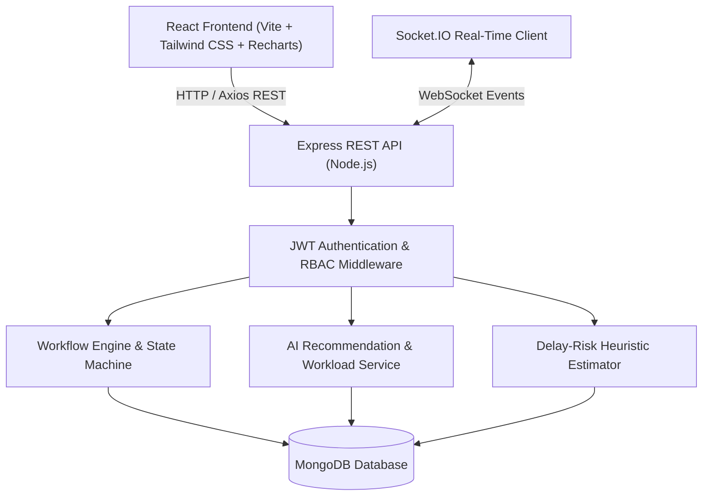
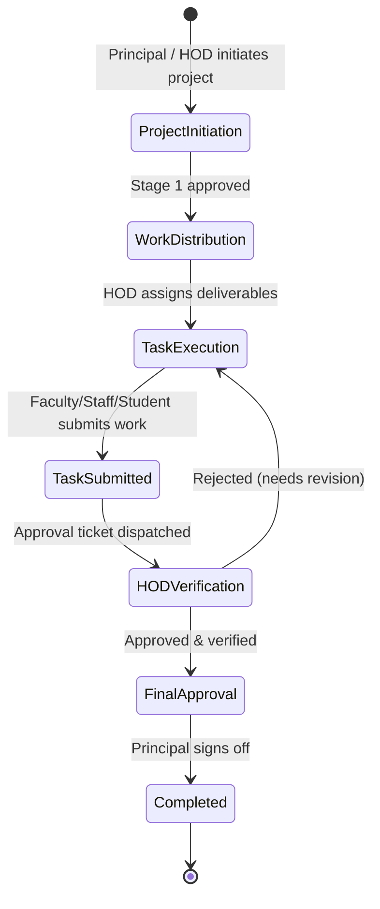

# System Architecture & Technical Specifications

**Project Title:** AI-Powered College Workflow and Intelligent Task Management System with Hierarchical Access Control  
**Stack:** MongoDB, Express.js, React.js (Vite + Tailwind CSS), Node.js, Socket.IO

---

## 1. High-Level Architecture Overview

---

## 2. Hierarchical Role-Based Access Control (RBAC) Matrix

| Capability / Resource | Super Admin (L6) | Principal (L5) | HOD (L4) | Faculty (L3) | Staff (L2) | Student (L1) |
|---|:---:|:---:|:---:|:---:|:---:|:---:|
| System Settings & Global Audit Logs |  |  |  |  |  |  |
| Department Creation & Deletion |  |  |  |  |  |  |
| User Account Creation | All Roles | All Roles | Dept Faculty/Staff/Students |  |  |  |
| Department Isolation Boundary | Global | Global | Own Dept | Own Dept | Own Dept | Own Dept |
| Project Creation |  |  |  |  |  |  |
| Advance Workflow Stage |  |  |  |  |  |  |
| Task Creation & Assignment |  |  |  |  |  |  |
| Task Submission for Approval |  |  |  |  |  |  |
| Deliverable Verification & Sign-Off |  |  |  |  |  |  |
| AI Task Assignment Recommendations |  |  |  |  |  |  |
| CSV Report Exports |  |  |  |  |  |  |

---

## 3. Workflow Progression & State Machine

---

## 4. AI Recommendation & Workload Model Specifications

### 4.1 Intelligent Task Assignment Formula
The multi-criteria recommendation scoring function computes candidate suitability:

$$\text{Suitability Score} = S_{\text{skills}} + S_{\text{workload}} + S_{\text{completion}} + S_{\text{role}}$$

Where:
- **Skill Match Score ($S_{\text{skills}}$)**: Up to 40 points based on keyword overlap between task requirements and candidate profile.
- **Workload Score ($S_{\text{workload}}$)**: Up to 30 points (inversely proportional to active tasks: 0 tasks = 30 pts, 1-2 = 24 pts, 3-4 = 16 pts, 5-6 = 8 pts, 7+ = 2 pts).
- **Completion Track Record ($S_{\text{completion}}$)**: Up to 20 points based on verified completed deliverables.
- **Role Alignment ($S_{\text{role}}$)**: Up to 10 points based on task priority and seniority alignment.

### 4.2 Explainable Delay-Risk Radar
Evaluates deadline proximity, velocity deficit, and blocked prerequisites:
- **Deadline Proximity**: Overdue tasks trigger a +50 point penalty with immediate escalation status.
- **Progress Deficit**: Evaluates expected progress:
  $$\text{Expected Progress} = \min\left(100, \frac{\text{Elapsed Days}}{\text{Total Duration Days}} \times 100\right)$$
  Deficit > 40% triggers a +30 point risk penalty.
- **Blocked Dependencies**: +15 points per uncompleted prerequisite.
- **Categorization**:
  - Score $\ge 60$ or Overdue $\rightarrow$ **High Delay-Risk** (Red)
  - Score $35 - 59$ $\rightarrow$ **Medium Delay-Risk** (Amber)
  - Score $< 35$ $\rightarrow$ **Low Delay-Risk** (Green)

